<!-- Three Worlds profile README. SVG cards are rendered by scripts/render_readme_cards.py. -->

  

---

[Portfolio](https://tawqeer.is-a.dev) · [GitHub](https://github.com/1k24bytes) · [Email](mailto:tawqeerdar21@gmail.com)
